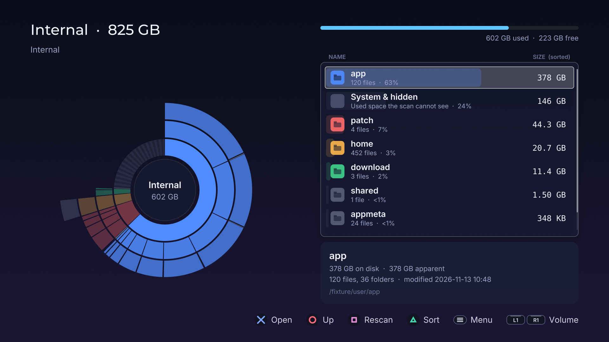
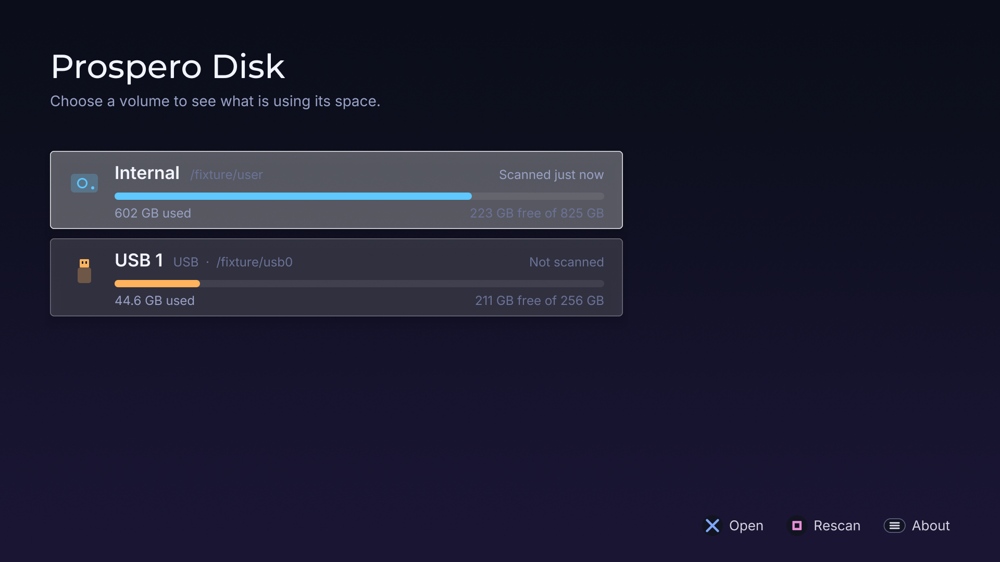

# Prospero Disk

Shows what is using the storage on a jailbroken PS5. It scans a drive quickly
and draws the result as an interactive sunburst next to a sorted list, all
driven by the controller. It only reads: it shows sizes and never changes or
deletes anything.



## Install

1. Download `prospero-disk-<version>-PPSA93475.zip` from the
   [latest release](https://github.com/leolobato/prospero-disk/releases/latest).
2. Unzip it and copy the `PPSA93475` folder to `/data/homebrew/` on the
   console (with FTP or a file manager), so the app ends up at
   `/data/homebrew/PPSA93475`.
3. Wait about ten seconds for the console to register the title. Prospero Disk
   then appears on the home screen.
4. Before you launch it, start a resident Lapy service or the ELF loader on
   port 9021 (see [Access](#access)).

Tested on firmware 13.60.

To update, replace the `PPSA93475` folder with the one from the new release.

## Using it



| Screen | Buttons |
| --- | --- |
| Volumes | Cross opens the last scan (or starts one), Square rescans, Options shows About |
| Scanning | Circle cancels. What was found so far opens as a partial scan |
| Explore | The D-pad moves through the list, the right stick aims at a segment, Cross opens a folder, Circle goes up, Triangle sorts by size or name, Square rescans, Options opens the menu (Rescan, Scan details, About), L1/R1 switch volume |

- **System & hidden**: at the top of a volume, this entry is the used space
  the scan cannot see, so the numbers add up to the drive's used space.
- **Game names**: folders named after a title ID (`PPSA01467`,
  `PPSA01467-app0` and the like) show the game's name and icon. So do
  Playden's game folders (`playden/games/2610`).
- **Other languages**: names in Japanese, Korean, Chinese, Thai or Arabic are
  drawn with the console's own fonts.
- **Cache**: scans are saved in `/data/prospero-disk/cache`, so opening a
  volume again shows the last scan without scanning again. Square rescans it.

## Access

When it starts, the app asks for full file-system access through Lapy, so a
resident Lapy service or the ELF loader on port 9021 must be running. Without
it, the app still opens: it shows a "Limited access" banner and lists only the
volumes it can read. Its cache is then kept in the app's own storage.

## Known limits

Not yet checked on a console: scanning USB drives, the console fonts for
non-Latin scripts, and whether the "System & hidden" total adds up exactly.
Please open an issue if you try any of these.

## Building

Needs Linux (or WSL) with clang 18, ninja, ccache, Python 3, clang-format-18
and clang-tidy-18 (`make doctor` checks them). Every dependency (the Payload
SDKs, ps5-opengl, HarfBuzz, the Lapy helper) is downloaded at a pinned version
and hash-checked.

```bash
make                       # dist/PPSA93475 and dist/PPSA93475.zip
make test-unit             # unit tests, with sanitizers
make lint                  # format, clang-tidy, headers, metadata
APP_LAPY_HELPER=0 make     # without the elevation helper
```

Built on [ps5-homebrew-ui](https://github.com/blackbearreloaded/ps5-homebrew-ui).
The design is described in [docs/PRD.md](docs/PRD.md).

## License

GPL-3.0-or-later, the same as ps5-homebrew-ui and ProsperoEden. See
[LICENSE](LICENSE) and [THIRD_PARTY_NOTICES.md](THIRD_PARTY_NOTICES.md).
